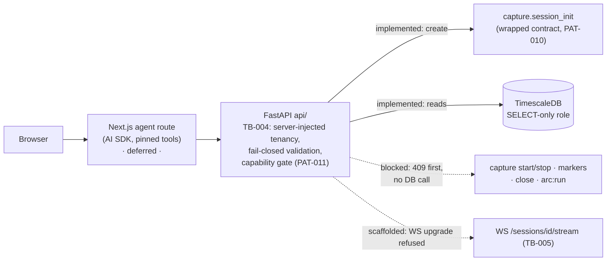

# UI ↔ Backend Integration

Living document. Anything concerning connecting the future researcher UI
(Phase 4b operator surface and beyond) to this backend lives here: which code
is the contract surface, what was deliberately deferred until the UI exists,
and what must be added or changed when it lands. Companion to
[decisions.md](decisions.md) ("Real-Time Delivery": any API wraps existing
contracts instead of replacing them).

## 0. Operator UI surface — capability status (June 2026)

The operator UI is being built as a **staged agentic surface** (Next.js chat GUI
+ Vercel AI SDK → thin FastAPI `api/` → the §1 contracts below). Contract
authority is [`.correctless/specs/operator-ui.md`](../.correctless/specs/operator-ui.md)
(HIGH intensity); the staged-build decision is in
[decisions.md](decisions.md) ("Operator UI — Staged Agentic Surface").

Capabilities are tagged by status. `implemented` = wired + tested; `scaffolded`
= surface present (tab / tool-registry entry) with a documented contract but no
execution; `blocked` = a disabled tool with no execution. **Capability gating is
server-side and explicit** — non-`implemented` endpoints are *present* and fail
closed with a structured `409 Capability unavailable` body
(`{error, capability, status, blocked_reason, gate}`) returned before any DB
call; the scaffolded WebSocket refuses the upgrade with a capability-status close
reason. `GET /capabilities` returns the whole matrix so the UI sources tool state
at runtime. Hiding buttons/tools in the UI is **insufficient**.

| Capability | Endpoint / tool | Status (Milestone 0) |
|---|---|---|
| Health | `GET /health` | implemented |
| Capabilities discovery | `GET /capabilities` | implemented |
| Vocab | `GET /vocab` | implemented |
| List sessions | `GET /sessions` | implemented (read-only query; optional filters, see below) |
| Session status | `GET /sessions/{id}/status` | implemented |
| Create session | `POST /sessions` | implemented (wraps `create_session`) |
| Live biosignal tab | `WS /sessions/{id}/stream` | scaffolded (WS upgrade refused; tab placeholder) |
| ARC review tab | `GET /sessions/{id}/arc` | scaffolded (409 capability-status; tab placeholder) |
| Agent tool execution | AI SDK tool registry | scaffolded (visible, execution disabled) |
| Capture start/stop | `capture:start` / `:stop` | **blocked** (409) |
| Marker publish | `POST /sessions/{id}/markers` | **blocked** (409) |
| Close session | `POST /sessions/{id}/close` | **blocked** (409) |
| ARC run | `arc:run` | **blocked** (409) |

**Session list filters** (`.correctless/specs/session-query.md`). `GET /sessions`
accepts optional `session_id` (UUID prefix), `participant_id` (full UUID),
`status`, `compound`, `created_from` (inclusive) and `created_before` (exclusive,
ISO 8601 dates or datetimes with a UTC offset) and `limit` (1 to 500, default
200). Filters combine with AND inside the sponsor and site scope. Invalid values
return the structured 422 before any database work. The response fields do not
change: `participant_id` is never returned.

**M1 entry gates** (M0 stays read/scaffold-only; no write/exec capability is
enabled until its gate is specified):

- **Capture start/stop, marker publish, close session** — gated on **OQ-004**:
  capture process ownership under FastAPI (subprocess ownership, duplicate-start
  prevention, graceful shutdown, restart, orphan recovery). Markers must publish
  via the LSL outlet, never `echo_events` (spec INV-003).
- **ARC run** — must not run before `watermark_verified` (spec INV-006; AGENTS.md
  non-negotiable); gated end-to-end before enabling.
- **Real agent tool execution** — enabled only once the above are real and
  **OQ-001** is settled: an authentication model AND a tenant-authorization model.
  **Localhost tenancy is not authentication.**

Binding rules for the surface: the API **wraps** the §1 contracts (never
duplicates them); direct SQL is read-only + parameterized (no `SessionRepository`);
the model never supplies `sponsor_id`, SQL, shell, or endpoint paths — **FastAPI
owns tenant context and authorization** (server-injected).

## 1. The de-facto backend API (what a UI calls today)

These are the boundaries a UI/API layer wraps. They are spec-pinned and
tested — do not redesign them for the UI; wrap them.

| Capability | Contract | Notes for UI |
|---|---|---|
| Create session | `capture.session_init.workflow.create_session(compound=…, site_id=…, sponsor_id=…, participant_id=…, capture_source=…, …electrode kwargs)` → session UUID | Validates inputs (ValueError) **before** any DB connect — safe to surface errors directly as form feedback. Valid choice sets exported as `VALID_COMPOUNDS` / `VALID_DOSE_UNITS`; CLI argparse choices in `capture/session_init/cli.py` are the same sets a UI dropdown should use. |
| Run capture | `capture.watchdog` (supervised) / `capture.lsl_forwarder` (direct), launched as a process | UI starts/stops the watchdog process; SIGTERM is the clean-stop signal. Watchdog sets session status (`closing` / `failed`). |
| Log context events | LSL marker stream consumed by `capture.echo_handler` | UI marker buttons should publish to the LSL marker outlet (like `capture/marker_simulator.py` does) — **not** write `echo_events` directly. |
| Close session | `capture.session_close.workflow.run(session_id, sponsor_id, xdf_path)` → exit code 0/1/2 | Accepts `str` or `Path` for `xdf_path` — coercion added specifically for non-CLI callers. |
| ARC post-session | `batch.arc.processor.run_arc_post_session(conn, session_id, sponsor_id, config_path)`; preflight gate `batch.arc.preflight.assert_arc_temporal_alignment(conn, session_id, sponsor_id, …)` | Selected ARC entry points accept sponsor scope. The complete ARC lifecycle and tenancy sweep remain unfinished; do not expose ARC as a trusted UI workflow yet. |
| Session status / progress | `sessions.status` + watermark events in `audit_events` (`watermark_verified` / `watermark_failed`) | UI polls these reads; never writes `audit_events` (trigger-owned). |

## 2. Deferred until the UI exists (deliberate, June 2026)

Deferred because both ends of the session-init chain are spec-pinned kwargs
contracts today — these abstractions need a real second consumer to be
designed against, not speculation:

- **`SessionRequest` dataclass** — typed request object with `__post_init__`
  validation. Design it against the actual UI/API request shape when that
  spec is written; today's validation already lives at the top of
  `create_session`.
- **`SessionRepository`** — persistence layer behind session init. One CLI
  workflow with one transaction doesn't justify it; an API server with
  concurrent handlers will.
- **Connection pooling** — revisit when the API layer creates concurrent
  handlers (db-health §1.2 threshold note).
- **Aborted-session state** — clinically significant terminal state with its
  own watermark path (db-health §3.2, rollup #1, Phase 5b).

## 3. Integration principles (binding)

1. The API layer **wraps** the contracts in §1 — it never duplicates their
   logic or reaches past them into SQL.
2. UI never writes to the DB directly. Reads preserve tenancy boundaries
   (`site_id`, `sponsor_id` in every query).
3. Pseudonymous participant IDs only — the UI must not collect or display PII.
4. Context markers go through LSL (so XDF stays the recovery source of
   truth), not through DB inserts.
5. Runtime config stays in `config/settings.py` + `.env`; the UI does not
   introduce its own config store for backend behavior.

## 4. When the UI lands — work checklist

- [ ] Write the UI/API spec (`.correctless/specs/`) before code; it pins the
      request/response shapes and is when `SessionRequest` gets designed.
- [ ] Thin FastAPI (or equivalent) app exposing §1 contracts; no broad app
      (decisions.md "Real-Time Delivery").
- [ ] Process management story for watchdog/forwarder start-stop from the UI
      (the `ForwarderEngine` lifecycle is the intended hook).
- [ ] Status endpoint over `sessions.status` + watermark audit events.
- [ ] Marker-entry component publishing to the LSL marker stream.
- [x] Isolated test database: the test environment targets a dedicated DB
      (`untitled_project_test`) distinct from any live/production DB; because the
      wrapped `create_session` writes via `DATABASE_URL` and integration fixtures
      read back via `TEST_DATABASE_URL`, both point at that same isolated test DB
      during testing (the dev DB `untitled_project_local` stays untouched). A real
      local capture run requires flipping `DATABASE_URL` back to the dev DB.
- [ ] Revisit deferred items in §2.
